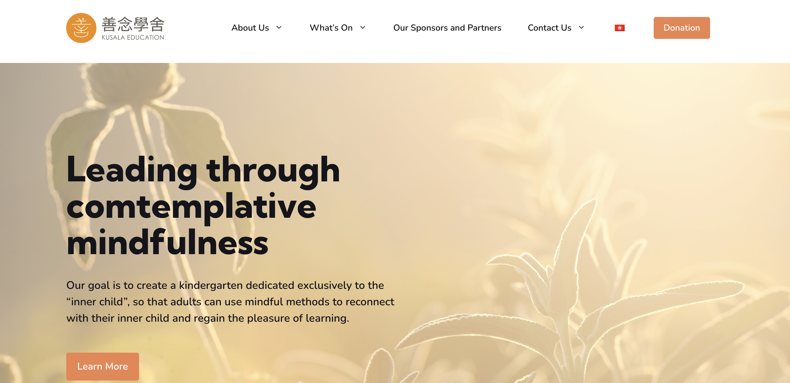

## Overview

I worked on the revamp of Kusala's official website alongside the Kusala team and [Mino Digital](https://minodigital.io/). It was great getting to work with such wonderful people, and I learned a lot about website building and design in the process!

