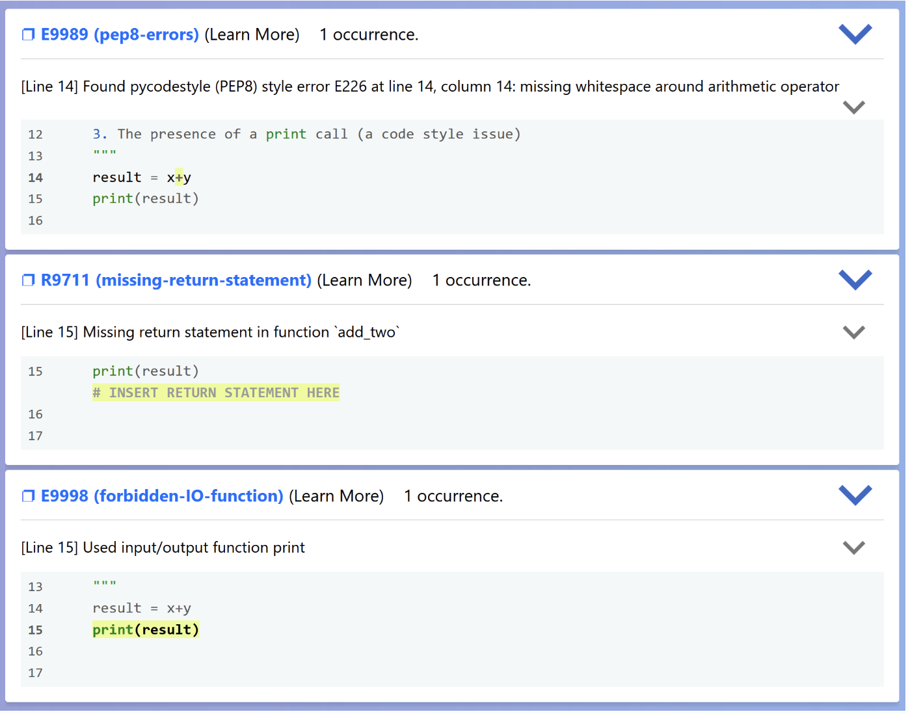

## Overview

I developed new features for [PythonTA](https://github.com/pyta-uoft/pyta) as a member of the Students Developing Software (SDS) Team at the University of Toronto.

<!-- This was my very first time contributing to an open-source project, so I was understandably nervous about everything.

### Combating imposter syndrome -->
